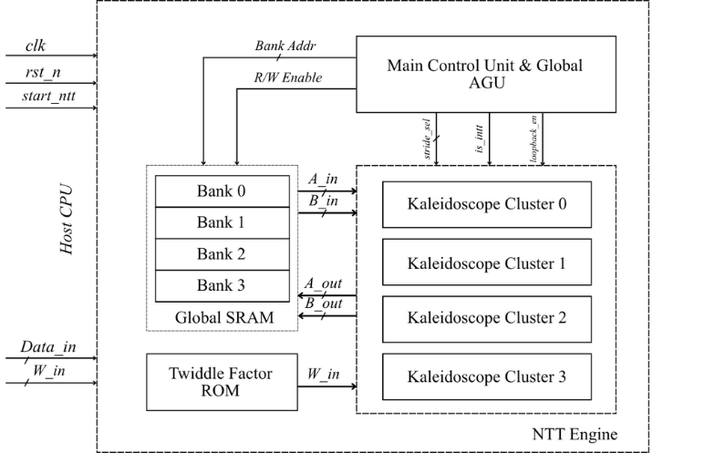
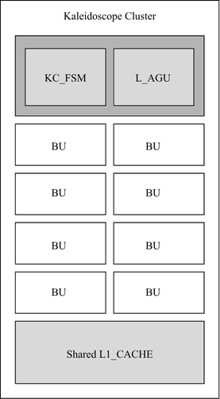
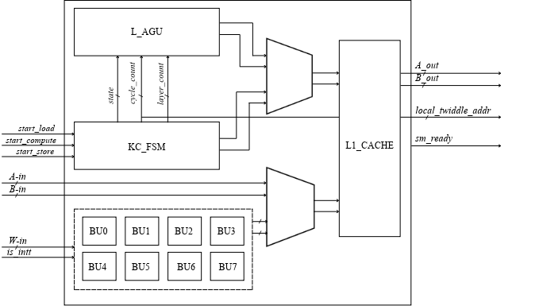
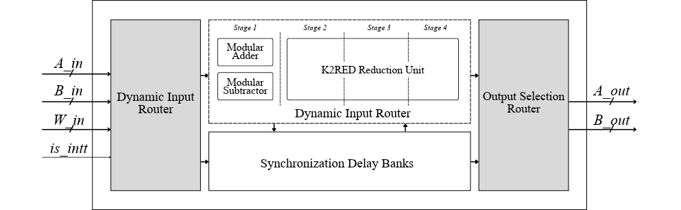

# NTT Engine with Novel Kaleidoscope Cluster Architecture

<p align="center">
  
</p>

<p align="center">
  <b>A SystemVerilog based, Pipelined NTT/INTT Engine Featuring Four Parallel Kaleidoscope Clusters, Hierarchical Address Generation and Division free Modular Reduction for ML-KEM Post-Quantum Cryptographic Workloads.</b>
</p>

<p align="center">
  
  
  
  
  
  
</p>

---

## Table of Contents

- [Overview](#overview)
- [Motivation](#motivation)
- [Key Features](#key-features)
- [Architecture](#architecture)
- [Kaleidoscope Cluster](#kaleidoscope-cluster)
- [Pipelined Butterfly Unit](#pipelined-butterfly-unit)
- [Modular Arithmetic](#modular-arithmetic)
- [Execution Strategy](#execution-strategy)
- [Current Progress](#current-progress)
- [Verification](#verification)
- [Repository Structure](#repository-structure)
- [Future Work](#future-work)
- [Getting Started](#getting-started)
- [Author](#author)
- [License](#license)

---

# Overview

This repository contains the SystemVerilog RTL implementation and simulation environment for an ASIC-oriented hardware accelerator for ML-KEM polynomial arithmetic.

The proposed architecture combines a hierarchical memory organization with four parallel Kaleidoscope Clusters, each containing eight butterfly units. The design integrates pipelined NTT/INTT computation, custom address generation and division free K2RED modular reduction to improve computational efficiency and reduce global memory traffic.

The accelerator targets efficient implementation of the polynomial arithmetic required by ML-KEM, standardized in NIST FIPS 203.

---

# Motivation

ML-KEM relies on polynomial arithmetic over the finite field defined by the modulus \(q = 3329\). Its computational workload includes repeated modular multiplication, addition, subtraction, and NTT/INTT butterfly operations.

Implementing these operations efficiently in hardware presents several challenges:

- High computational demand from polynomial transformations
- Significant data movement between memory and processing units
- Complex coefficient addressing across NTT stages
- Hardware overhead associated with modular reduction
- The need for predictable execution in security-sensitive cryptographic hardware

This project explores a parallel, memory-efficient architecture using localized computation, hierarchical address generation, and optimized modular arithmetic.

---

# Key Features

- Four parallel Kaleidoscope Clusters
- Eight butterfly units per cluster
- Forward NTT and inverse NTT butterfly processing
- Four-stage pipelined butterfly datapath
- Division-free K2RED modular reduction
- Hierarchical global and local address generation
- Localized polynomial data processing
- FSM-controlled cluster execution
- SystemVerilog RTL implementation
- Simulation-based functional verification
- ASIC-oriented architecture

---

# Architecture

## Top-Level Architecture

<p align="center">
  
</p>

The proposed NTT engine consists of:

- Main Control & Global Address Generation Unit (Global AGU)
- Global SRAM
- Twiddle Factor ROM
- Four parallel Kaleidoscope Clusters
- Local storage and butterfly processing units

The Global AGU manages polynomial addressing at the system level, while the clusters perform localized arithmetic operations. This two-tier organization aims to reduce repeated global memory accesses and improve processing-unit utilization.

---

## Kaleidoscope Cluster

<p align="center">
  
</p>

Each Kaleidoscope Cluster is an autonomous compute unit responsible for localized polynomial processing.

Its primary components include:

- **Cluster FSM:** Coordinates LOAD, COMPUTE, and STORE phases.
- **Local AGU:** Generates local coefficient addresses and access strides.
- **Eight Butterfly Units:** Execute parallel modular arithmetic operations.
- **Local Storage:** Holds the coefficients and intermediate data needed for computation.

### Internal Cluster Architecture

<p align="center">
  
</p>

The cluster controller coordinates data movement and arithmetic execution. Local address generation supports stage-dependent coefficient access patterns.

---

## Pipelined Butterfly Unit

<p align="center">
  
</p>

The butterfly unit implements a four-stage datapath designed for modular arithmetic and synchronized data routing.

### Pipeline Stages

1. Modular addition and subtraction
2. Dynamic input routing and twiddle-factor synchronization
3. Division-free K2RED modular reduction
4. Output selection and routing

### Forward NTT Butterfly

For input coefficients \(A\), \(B\), and twiddle factor \(W\):

\[
A' = (A + BW) \bmod q
\]

\[
B' = (A - BW) \bmod q
\]

### Inverse NTT Butterfly

\[
A' = (A + B) \bmod q
\]

\[
B' = (A - B)W^{-1} \bmod q
\]

where \(q = 3329\) is the ML-KEM modulus. The complete inverse transform must also account for the required normalization.

---

# Modular Arithmetic

The accelerator uses specialized arithmetic units to perform polynomial operations efficiently.

### Supported Operations

- Modular addition
- Modular subtraction
- Modular multiplication
- Division-free K2RED modular reduction

The K2RED reduction unit is designed to reduce multiplication results modulo \(q\) without requiring a general-purpose divider.

These arithmetic blocks form the foundation of the NTT/INTT butterfly datapath.

---

# Execution Strategy

The proposed architecture divides polynomial processing into three execution phases.

### 1. Global Horizontal Processing

The Global AGU accesses the polynomial during early transformation stages, including strides of 128 and 64.

### 2. Local Horizontal Processing

The polynomial is partitioned into 64-coefficient blocks for localized processing. The Local AGU generates access patterns for stages with strides of 32 and 16.

### 3. Interleaved Local Processing

During later transformation stages, the Local AGU schedules accesses across smaller coefficient groups to keep the pipelined butterfly units supplied with data.

The intended benefits are reduced global memory traffic, improved pipeline utilization, and efficient parallel processing.

---

# Current Progress

The following components have been implemented in SystemVerilog and verified through RTL simulation:

- **Modular Arithmetic:** Addition, subtraction, multiplication, and K2RED reduction.
- **Forward NTT Butterfly:** Arithmetic datapath and operation verified.
- **Inverse NTT Butterfly:** Inverse butterfly datapath and operation verified.
- **Local AGU:** Local coefficient addressing and stride patterns verified.
- **Kaleidoscope Cluster FSM:** LOAD, COMPUTE, and STORE sequencing verified.

The complete accelerator remains under development, with system-level integration and ASIC evaluation planned as subsequent milestones.

---

# Verification

RTL verification focuses on arithmetic correctness, address generation, data routing, and controller behavior.

### Verification Coverage

- Modular arithmetic operations
- K2RED modular reduction
- Forward NTT butterfly
- Inverse NTT butterfly
- Local AGU address generation
- Cluster FSM sequencing
- Individual RTL module simulation

Full accelerator-level verification, including end-to-end polynomial transformations and integrated control, remains part of the planned work.

---

# Repository Structure

```text
.
├── NTT Design/
│   └── SystemVerilog RTL source files
│
├── NTT Sim/
│   └── Testbenches and simulation files
│
├── docs/
│   └── images/
│       ├── top_architecture.png
│       ├── kaleidoscope_arch.png
│       ├── kaleidoscope_internal.png
│       └── butterfly_unit.png
│
├── README.md
└── LICENSE
```

---

# Future Work

Planned improvements include:

- Point-wise polynomial multiplication
- Global AGU and global control logic
- Complete accelerator integration
- End-to-end NTT/INTT verification
- Constant-time execution analysis and validation
- Full RTL synthesis and ASIC evaluation
- Area, power, timing, throughput, and latency analysis

---

# Getting Started

## Clone the Repository

```bash
git clone https://github.com/svsBishal/neu_em_a_ml_kem_asic_accelerator_.git

cd neu_em_a_ml_kem_asic_accelerator_
```

## Run Simulation

1. Open the RTL files in `NTT Design/`.
2. Locate the relevant testbenches in `NTT Sim/`.
3. Compile the required SystemVerilog modules using your preferred simulator.
4. Run the testbench and inspect the simulation results.

Supported simulators may include:

- ModelSim / QuestaSim
- Vivado Simulator
- Synopsys VCS
- Cadence Xcelium

The exact compile commands depend on the selected testbench and its module dependencies.

---

# Author

**Bishal Sarma**

Department of Electronics and Communication Engineering  
National Institute of Technology Silchar

GitHub: [svsBishal](https://github.com/svsBishal)

---

# License

Add the appropriate license file to specify the terms under which this project may be used, modified, and distributed.
